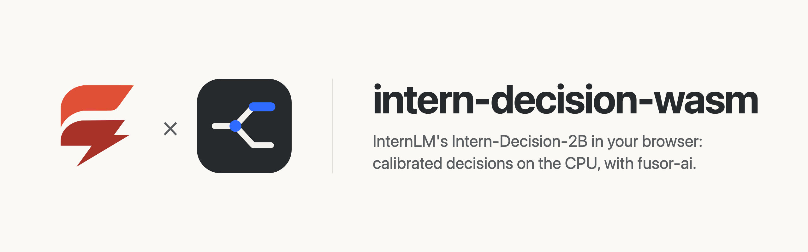
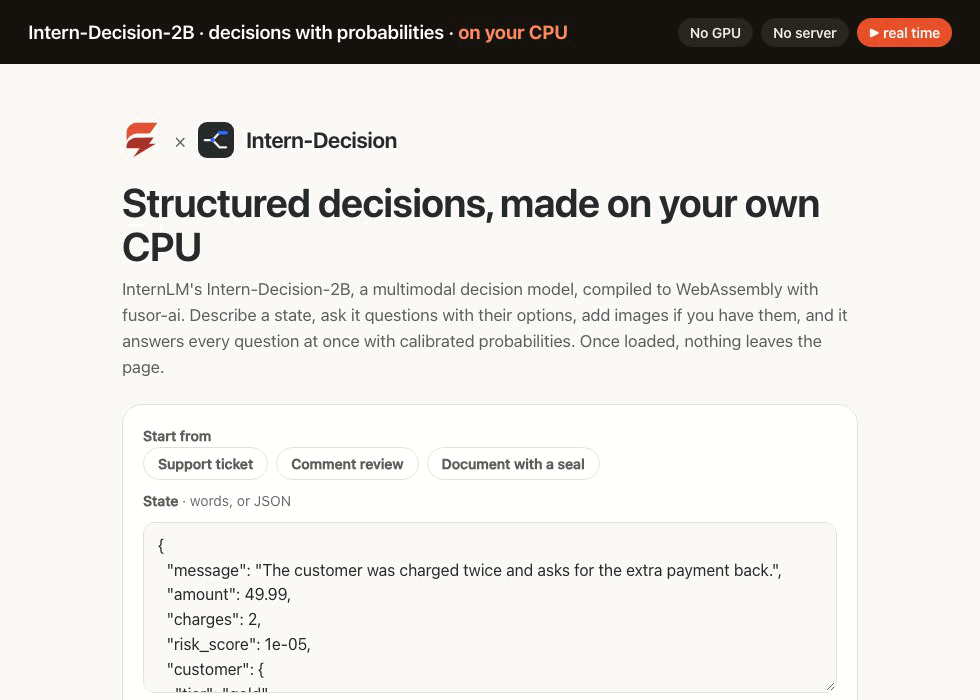
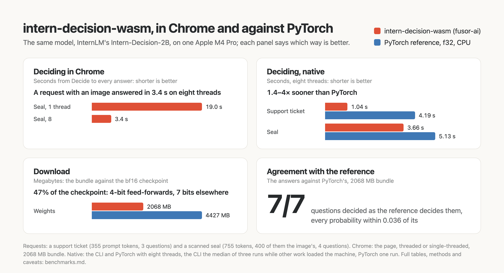

<p>
  <picture>
    <source media="(prefers-color-scheme: dark)" srcset="assets/brand/banner-dark.png">
    
  </picture>
</p>

# Structured decisions in the browser, on the CPU

**[Try it in your browser](https://huggingface.co/spaces/fusorlabs/intern-decision-wasm)**: no install, no server. The model downloads once and runs on your CPU.

**Four questions about a scanned seal decided in 3.4 s**, in Chrome on an Apple M4 Pro, eight threads. [Benchmarks](benchmarks.md)

<a href="https://huggingface.co/spaces/fusorlabs/intern-decision-wasm"></a>

Describe a situation, ask questions about it with their options, add images if you have them, and get every answer at once with calibrated probabilities: InternLM's [Intern-Decision-2B](https://huggingface.co/internlm/Intern-Decision-2B), a 2B multimodal decision model, computed on your own device. No server, no API key, no GPU required, and once the model has loaded, nothing you type or drop leaves the page.

intern-decision-wasm is the app around the model: a [fusor](https://github.com/fusor-rs/fusor) page, the browser runtime and a native CLI. The model itself, compiled to WebAssembly, is built with [fusor-ai](https://github.com/fusor-rs/fusor-ai), the toolkit for AI runtimes in Rust and WebAssembly, from the published weights.

**In development · v0.1**: this is experimental software. See [status and known limitations](#status-and-known-limitations).

[Run it](#run-it-locally) · [Try it online](#try-it-online) · [How it works](#how-it-works) · [How fast is it](#how-fast-is-it) · [Benchmarks](benchmarks.md) · [Status](#status-and-known-limitations)

## Run it locally

You need Rust 1.99 or newer, installed with [rustup](https://rustup.rs), Node.js 22 or newer and [`just`](https://github.com/casey/just). Then:

```sh
git clone --recurse-submodules https://github.com/fusor-rs/intern-decision-wasm && cd intern-decision-wasm
just ui
```

and open the address it prints. `just ui` installs the pinned tools (the threads toolchain with rustup; wasm-bindgen, binaryen and the fusor CLI into `.tools/`), downloads the checkpoint at a pinned revision (4.4 GB, each file sha256-checked), compiles it into a 2068 MB bundle, builds the four browser runtimes (a few minutes the first time, seconds after) and the page, and serves it on `http://localhost:8787` with the bundle beside it.

Start from an example (a support ticket, a comment to review, a document with a seal) or write your own: the **state** in words or as JSON, and the **questions** as a JSON object, each a `choice` among described options, a `score` on a scale, or a yes-or-no `noul`, as the model card describes them. Add images by dropping, pasting or choosing them, and press **Decide**, even while the model is still loading: the request is decided the moment the model is ready. Each question comes back with its decision and every option's probability as a bar, a score with its expected value, and the response's JSON to copy. Every decision is measured live: the time from Decide to the answers, the prompt's tokens read per second, its tokens and its images', and the network requests since the model loaded, which stay at zero.

## Try it online

Open the Hugging Face Space [fusorlabs/intern-decision-wasm](https://huggingface.co/spaces/fusorlabs/intern-decision-wasm) in Chrome or Edge. The page downloads the 2068 MB model once and keeps it in the browser's storage, so the next visit loads in about a second.

## More ways to run it

### Build everything from source

```sh
just build    # also downloads the checkpoint (4.4 GB, sha256-checked) and compiles the bundle
just serve
```

`CHECKPOINT=<dir>` reuses a checkpoint you already have, `PROFILE=q7` compiles the 2521 MB bundle with every large matrix in 7 bits, and `PROFILE=f32` the 8.9 GB full-precision one that `just parity` checks against the reference.

### The CLI

The CLI decides the requests of a JSON file without a browser, each as the reference's `DecisionEngine.predict` takes it, its images' paths relative to `--images`:

```sh
target/release/intern-decision decide dist/model fixtures/requests.json --images fixtures/images
```

`intern-decision bench` measures each stage on a request and `intern-decision parity` compares every stage with the reference's outputs.

## How it works

- **One pass, no generation.** The request is compiled into a chat as the checkpoint's own `inference.py` compiles it: the system prompt, the state and a decision schema listing every option under a single-token symbol, and the assistant's answer already written, a JSON object with a `<decision>` marker per question. One forward pass reads it all; the logits of the row before each marker, over that question's symbols only, are its answer, and the checkpoint's calibration temperature (2.1005) rescales them.
- **The reference's prompt, token for token.** The questions keep their order and the state's JSON is written as Python's `json.dumps` writes it, floats as `repr` writes them, so the prompt's ids are the reference's one for one.
- **A hybrid language model.** Qwen3.5 2B's 24 layers mix tokens two ways: every fourth with gated attention (eight query heads over two key and value heads, a quarter of each head rotated by interleaved multimodal RoPE, the output gated by a sigmoid), the others with the gated delta rule, a linear attention whose 128 × 128 memory per head carries from chunk to chunk of the prompt. fusor-ai's new `hybrid` block runs both on the same int8 kernels as the weights; by arithmetic the rule's recurrence is about 0.5% of the matrix products.
- **Only the logits it needs.** The 248 320-word head is never computed: each question needs the logits of its options' symbols, a few dot products with the head's rows.
- **Images as the model sees them.** Resized to whole 32-pixel blocks within a pixel budget and cut into 16 × 16 patches, read by a 24-layer NaViT encoder with the learned position grid resampled corner to corner as Qwen3-VL does it, and merged 2 × 2 into the language model's tokens, each placed by its row and column.
- **Quantized where it holds.** The feed-forwards are 4-bit and everything else 7-bit, 2068 MB against the checkpoint's 4.4 GB. The mixers or the embeddings in 4 bits too flip the fixtures' closest decision ([benchmarks](benchmarks.md#agreement-with-the-reference)).
- **One stage per step.** The engine worker decides in steps (each image through the vision tower, then the prompt 128 tokens at a time) and posts each, so the page shows the progress and Stop takes effect between steps.
- **Threads and SIMD where the browser has them.** The page picks one of four builds: worker threads when it is cross-origin isolated, relaxed SIMD when the engine supports it, plain SIMD128 everywhere else.
- **Downloaded once, verified always.** The bundle streams in parts, each checked against its BLAKE3 hash, and stays in the browser's origin-private storage, so the next visit loads from this device in about two seconds.
- **Sealed.** The runtime imports no network, storage, clock or entropy capability; fusor-ai's import check proves it on every build. The page counts its network requests while it decides, and the count is zero.

## How fast is it

On an Apple M4 Pro in Chrome on eight threads, the page answers four questions about a scanned seal, 755 prompt tokens of which 400 are the image's, in 3.4 s; on one thread, in 19 s. Natively it decides 1.4–4× sooner than the PyTorch reference, and every fixed question is decided as the reference decides it. [benchmarks.md](benchmarks.md) has the full measurements:

<picture>
  <source media="(prefers-color-scheme: dark)" srcset="assets/benchmarks/benchmarks-dark.png">
  
</picture>

## Documentation

| Guide | Covers |
| --- | --- |
| [Benchmarks](benchmarks.md) | Time to the answers, agreement with the reference and download, and how to reproduce them |
| [AGENTS.md](AGENTS.md) | The code standard every change follows |

## Status and known limitations

intern-decision-wasm is v0.1 and experimental.

| Platform or capability | Status |
| --- | --- |
| Chrome and Edge, threads and relaxed SIMD | Headless Chrome end-to-end check (`just e2e`): decide while loading, a request with an image, revisit |
| Browsers without relaxed SIMD (Safari, older Firefox) | SIMD128 builds, checked in Node (`just smoke`); not tested in those browsers |
| Pages without cross-origin isolation | Single-threaded builds: about 19 s for a request with an image on an Apple M4 Pro |
| Native CLI (macOS on Apple silicon) | Built and measured; no release archives yet |
| Phones | Not measured; the threaded builds' memory may grow to 4 GB |

**Not supported yet:**

- Prompts longer than 4096 tokens, images included (the reference allows 8192), and images beyond 1024 tokens each: a larger image is resized to fit.
- Video.
- A GPU backend.

The model is InternLM's [Intern-Decision-2B](https://huggingface.co/internlm/Intern-Decision-2B), under the Apache-2.0 license, derived from Qwen's [Qwen3.5-2B](https://huggingface.co/Qwen/Qwen3.5-2B) under its license; the bundle ships both beside the weights (`model/LICENSE`, `model/LICENSE-QWEN`). The test image is PaddleOCR's own test file (Apache-2.0), downloaded at a pinned commit.

## License

The code is licensed under the [MIT License](LICENSE). The model's weights are InternLM's, under [Apache-2.0](https://huggingface.co/internlm/Intern-Decision-2B/blob/main/LICENSE).
